# OpenConsent Plugin for WordPress

OpenConsent is a WordPress plugin designed to help website owners comply with cookie consent regulations (Google consent mode v2) by displaying a customizable cookie banner. It integrates with Google Tag Manager (GTM) and implements Google Consent Mode v2 (Basic) to manage how Google tags behave based on user consent. The plugin has been vibecoded to replace costly or bloated Wordpress consent plugins for that purpose.

## See it in action

## Features

* **Cookie Consent Banner:** Displays a customizable banner to obtain user consent for cookies.
* **Google Consent Mode v2 (Basic):**
    * Sets default consent states to 'denied' before any tags fire.
    * Updates consent states based on user interaction (Accept/Decline).
    * Dynamically loads Google Tag Manager only after consent is granted.
* **Customization:**
    * **Texts:** Configure the main banner message (supports HTML via WP editor), accept button text, decline button text, and the text for the minimized "re-open" widget.
    * **Appearance:** Adjust banner background color, text color, link color, and button background/text colors.
    * **Positioning:** Choose from 11 positions for the main banner (e.g., bottom full, top right, middle center).
* **Google Tag Manager Integration:** Easily add your GTM ID to inject the GTM script correctly based on consent.
* **Minimized Re-Open Widget:** After initial interaction, a small, clickable widget appears, allowing users to revisit and change their consent settings. (you can deavtivat that)
* **Enable/Disable:** Option to easily activate or deactivate the entire banner functionality.
* **Responsive Design:** The banner and widget are designed to adapt to different screen sizes.
* **NEW with v1.0.7:** Plugin is able to detect Google Site Kit and then change into compatiblity mode. It fully supports WP Consent API now.
* **NEW with v1.1.0:** Complete accessibility overhaul with WCAG 2.1 Level AAA compliance, Google Consent Mode v2 enhancements with conversion tracking support, settings import/export functionality, and improved security throughout.
* **NEW with v1.1.1:** Google Consent Mode v2 compliance fixes; removed broken no-op regional consent default.
* **NEW with v1.1.2:** Compliance and stability release.
    * Consent Mode: only real consent types are sent in `consent` commands (`ads_data_redaction` now uses `gtag('set', …)`); returning visitors who accepted get the consent update and GTM directly in `<head>`.
    * WP Consent API / Site Kit: correct categories (`statistics`, `marketing`, …), client-side updates, registered as an opt-in consent manager.
    * Withdrawal: declining removes Google Analytics/Ads cookies; new shortcode `[openconsent_settings_link]` to re-open the banner from any page.
    * New setting **Remember Choice For (Days)** (default 180 for new installs).
    * Better default banner text (purposes, Google as recipient, withdrawal, automatic privacy policy link).
    * Fixed settings export/import, keyboard access to the widget and the position of centred banners.

## Requirements

* WordPress 5.0 or higher (recommended)
* PHP 7.0 or higher (recommended)

## Installation

### Manual Installation

1.  Download `openconsent.zip` from the [latest release](https://github.com/vidual-labs/openconsent/releases/latest). Use this file, not GitHub's "Source code (zip)": only `openconsent.zip` contains the correct `openconsent` folder, so WordPress updates an existing installation instead of adding a second copy.
2.  In your WordPress admin panel, go to **Plugins > Add New**.
3.  Click **Upload Plugin** at the top.
4.  Upload the `openconsent.zip` file.
5.  Activate the plugin through the 'Plugins' menu in WordPress.

Alternatively, you can manually upload the unzipped `openconsent` folder to the `/wp-content/plugins/` directory on your server and then activate it from the Plugins page.

## Configuration

Once activated, you can configure the OpenConsent plugin by navigating to:

**Settings > OpenConsent** in your WordPress admin dashboard.

The settings page is divided into the following sections:

* **Plugin Status:**
    * **Enable Cookie Banner:** Globally activates or deactivates the banner and GTM integration.
* **General Settings:**
    * **Google Tag Manager ID:** Enter your GTM ID (e.g., `GTM-XXXXXXX`). Leave empty if not using GTM.
    * **Remember Choice For (Days):** How long the visitor's choice is stored before the banner asks again (1–390 days).
* **Banner Content & Texts:**
    * **Main Banner Message:** Use the rich text editor to craft your banner's main message, including any necessary information and links (e.g., to your Privacy Policy).
    * **Accept/Decline Button Text:** Customize the text for the consent buttons.
    * **Minimized Banner Text:** Set the text for the small widget that allows users to re-open the banner (default: "Cookie Settings").
* **Banner Design:**
    * **Banner Position:** Select the banner's position on the screen.
    * **Colors:** Customize background, text, link, and button colors.

Remember to click **Save Settings** after making changes.

## How It Works (Google Consent Mode v2 - Basic)

1.  **Default State:** When a new user visits your site, consent for all relevant storage types (`analytics_storage`, `ad_storage`, etc.) is defaulted to `denied` *before* any Google tags or GTM itself is loaded.
2.  **User Interaction:**
    * **Accept:** If the user clicks "Accept", the consent state is updated to `granted`. The page then reloads, and the GTM script (if an ID is provided) is injected, allowing your configured Google tags to fire with granted consent.
    * **Decline:** If the user clicks "Decline", the consent state remains `denied` (or is updated to `denied`). GTM is not loaded.
3.  **Persistence:** The user's choice is stored in a cookie (`openconsent_status`) for 180 days by default (configurable; sites updated from an earlier version keep 365 days until changed).
4.  **Withdrawal:** Declining after a previous acceptance removes the Google Analytics/Ads cookies (`_ga*`, `_gid`, `_gcl_*`, …) and GTM is no longer loaded.
5.  **GTM Loading:** The Google Tag Manager script is only loaded into the page *after* the user has explicitly granted consent. This is characteristic of a "Basic" Consent Mode implementation.

## Frontend Behavior

* **Initial Visit:** The full cookie consent banner is displayed according to your position and style settings.
* **After Interaction (Accept/Decline):** The main banner is hidden, and a small, clickable "widget" (e.g., "Cookie Settings") appears in the bottom-right corner (this widget's style is default, text is configurable).
* **Revisiting Consent:** Clicking this widget will re-display the main cookie consent banner, allowing users to change their previous settings.
* **Without the widget:** If you disable the widget, add the shortcode `[openconsent_settings_link]` (or any link to `#openconsent` / element with the class `oc-open-settings`) to your footer or privacy policy, so visitors can still withdraw consent.

## Using it with Google Site Kit

When Site Kit is active, OpenConsent only provides the banner and passes the choice on through the [WP Consent API](https://wordpress.org/plugins/wp-consent-api/). For this to work, install and activate the WP Consent API plugin and enable **Consent Mode** in the Site Kit settings.

## Your responsibilities

OpenConsent provides the technical consent signal. It is not legal advice. You still need a privacy policy that lists the services you use, and a banner text that names the purposes and recipients. All Google tags must be loaded through the GTM container (or Site Kit) — scripts embedded elsewhere in your theme are not blocked by this plugin.

## Development & Versioning

**Important:** Every commit to this repository includes a version bump and corresponding updates to the README and RELEASE_NOTES. See [CLAUDE.md](CLAUDE.md) for detailed development documentation and version management policies.

**Releases:** Publishing a GitHub release with a tag that matches the plugin version (e.g. `v1.1.3`) builds `openconsent.zip` and attaches it to the release automatically. The build fails if the tag and the version in `openconsent.php` differ.

## Changelog

See [RELEASE_NOTES.md](RELEASE_NOTES.md) for complete version history.

## Support

If you encounter any issues or have feature requests, please use the [GitHub Issues tracker](https://github.com/vidual-labs/openconsent/issues) 

## Contributing

Contributions are welcome! Please feel free to fork the repository, make changes, and submit a pull request.

## License

This plugin is licensed under the GPL v2 or later.
See the [LICENSE](https://www.gnu.org/licenses/gpl-2.0.html) file for more details.

## Author

Developed by [vidual](https://vidual.org).
Plugin page: [OpenConsent](https://github.com/vidual-labs/openconsent)

---

**Built with:**
- Initial development: Gemini 2.5 Pro
- v1.1.0 Refactoring & Enhancement: [Claude Code](https://claude.ai/code) (Anthropic)
- v1.1.1 Compliance Fixes: [Claude Code](https://claude.ai/code) (Anthropic): ✅Test succesful with WP 7.0, PHP 8.4 + ✅Compliance approved withGTM Tag Manager
- v1.1.2 Compliance & Stability Review: [Claude Code](https://claude.ai/code) (Anthropic)
- v1.1.3 Automated release ZIP: [Claude Code](https://claude.ai/code) (Anthropic)
